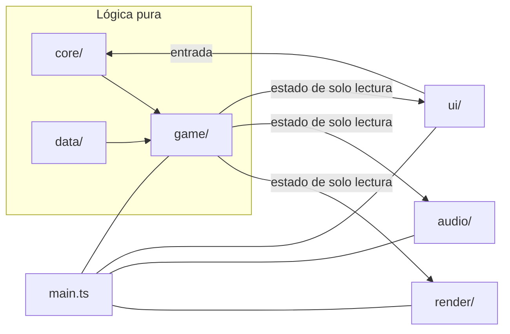

# Arquitectura de Zumbido

Zumbido es un juego estático para el navegador escrito en TypeScript, con Three.js (`WebGLRenderer`) para el 3D, WebAudio para el sonido y el DOM para la interfaz. No usa motor de juego, motor de física ni framework de interfaz. Vite empaqueta todo en `dist/`, sin peticiones a otros dominios.

La idea central es separar la **lógica**, pura y probada con tests, de la **presentación** (render, audio e interfaz), que solo lee el estado del juego.

## Mapa de carpetas

```
src/
  main.ts      arranque, estados de pantalla y bucle principal; une lógica y presentación
  core/        utilidades sin DOM: bucle de paso fijo, aleatoriedad con semilla, entrada, parámetros, resolución dinámica
  data/        datos del juego: identidad, niveles, equilibrio numérico, calidades, controles y todos los textos
  game/        lógica pura: generación del mundo, colisión, ruido, navegación, criatura, partida y progreso
  game/systems/  sistemas que se ejecutan en cada paso fijo, en un orden declarado en world.ts
  render/      escena 3D: mallas de chunks, luces, ambiente, objetos, criatura, cámara y HUD
  audio/       sonido sintetizado: zumbido ambiente, efectos, voz de la criatura y salida
  save/        guardado en localStorage con validación
  ui/          menús y pantallas, enlace con el navegador (teclado, ratón, captura del puntero)
tests/         pruebas de la lógica (Vitest)
public/        archivos estáticos (icono)
```

## Capas



`core/` y `game/` no importan Three.js ni tocan el DOM. Por eso la generación del mundo, la colisión, el ruido o el comportamiento de la criatura se pueden probar en Node sin navegador. `render/` y `audio/` nunca modifican el estado del juego: lo leen en cada frame.

## Ciclo principal

La lógica avanza en **pasos fijos de 1/60 s** (`core/loop.ts`). El render va a la frecuencia del monitor e interpola la posición entre el paso anterior y el actual. La mirada con el ratón se aplica en cada frame de render para que responda sin retraso, mientras que el movimiento se calcula en el paso fijo.

En cada paso, `World` (`game/world.ts`) ejecuta sus sistemas en este orden: movimiento, deriva, interacción, tiza, director de criaturas, criaturas, captura y señales de amenaza. Los sistemas no se llaman entre sí: comparten el estado de `World` y dejan sucesos (fusible recogido, captura, etc.) que la presentación consume después.

## Mundo procedural

El mundo es una cuadrícula de celdas de 3 m con paredes finas en sus bordes, dividida en **chunks** de 16×16 celdas (`game/worldgen.ts`). Cada chunk se genera con una función pura de la semilla, el nivel y sus coordenadas, así que el mismo chunk sale igual sin importar en qué orden se generen sus vecinos:

1. Las aberturas de cada borde se deciden con un hash del borde compartido, de modo que los dos chunks vecinos coinciden.
2. Se colocan salas (una sala de inicio fija en el origen, alguna grande y varias pequeñas).
3. Un árbol aleatorio (Kruskal) conecta todas las celdas y, con ellas, todas las aberturas.
4. Se quitan algunas paredes más para crear bucles y se reducen los callejones sin salida.
5. Según el nivel, se añaden columnas, estantes, paneles de luz y escondites.

Como cada chunk está conectado por dentro y cada borde tiene al menos una abertura, todo el mundo está conectado. Los tests lo comprueban con búsquedas reales sobre varias semillas fijas.

El mundo está acotado a ±1000 chunks desde el origen, más de lo que se recorre en una partida, para evitar problemas de precisión numérica. Solo se mantienen cargados los chunks cercanos (`game/streaming.ts`). Su construcción se reparte entre frames con un presupuesto de milisegundos (`render/world-view.ts`) y lo lejano se descarga liberando su memoria de GPU.

**Zonas (modo Deriva).** En Deriva, el mundo se divide en zonas de 4×4 chunks y el nivel de cada zona sale del hash de la semilla (`game/regions.ts`). Un borde entre zonas de niveles distintos usa siempre las reglas del mismo nivel visto desde los dos lados. Donde un techo es más alto que el del vecino, la malla añade un faldón. Al cruzar de zona, la niebla, la luz ambiente y el eco pasan al nuevo nivel de forma gradual (`render/ambience.ts`).

## Render

- Una malla fusionada por chunk para suelo, techo, paredes y columnas, y paneles de luz con `InstancedMesh`.
- Un grupo fijo de luces reales (de 4 a 6 según la calidad) que se reasignan a los paneles más cercanos; el resto de paneles solo brillan como material. El número de luces no cambia durante la partida.
- Texturas dibujadas con Canvas por código (`render/textures.ts`), una por nivel.
- Niebla para ocultar el límite de carga y tope de `devicePixelRatio` según la calidad. La resolución dinámica puede bajar la resolución interna si los FPS caen de forma sostenida.
- El parpadeo de las luces es una modulación suave de intensidad, por debajo de 3 cambios por segundo, y se desactiva con "Reducir parpadeo".

## Ruido y criatura

Cada acción del jugador emite un ruido con un alcance en metros. El alcance se mide **por los pasillos** (búsqueda en anchura sobre las celdas, `game/noise.ts`), así que las paredes bloquean el sonido.

La criatura (`game/enemy.ts`) es una máquina de estados determinista: vagar, investigar un ruido, perseguir, buscar al perder de vista y retirarse. Se mueve por caminos A* con un tope de nodos (`game/nav.ts`) y ve con un cono cuyo alcance depende de la luz y de si el jugador va agachado (`game/vision.ts`).

Un director (`game/director.ts`) decide cuándo y dónde aparece: lejos por camino y nunca a la vista del jugador. La dificultad elegida ajusta su oído, su vista y sus tiempos (`data/balance.ts`). En Deriva, su atención crece con el tiempo hasta un tope, sin que su velocidad de persecución llegue nunca a la de correr (`game/drift.ts`).

## Audio y señales visuales

Todo el sonido se sintetiza con WebAudio y pasa por un compresor y un limitador. La voz de la criatura usa audio espacial y su volumen depende de la distancia por los pasillos; con paredes de por medio suena apagada.

Toda señal sonora importante tiene también una señal visual: viñeta direccional, indicador de cercanía, nivel de ruido en el HUD y subtítulos de sonido opcionales (`ui/threat-cues.ts`, `render/hud.ts`).

## Persistencia

`save/storage.ts` guarda un único objeto JSON en `localStorage` bajo la clave `zumbido:v1`: ajustes, progreso, mejores tiempos, mejor deriva y última semilla.

Al leerlo se valida campo por campo (tipos, rangos y tamaño máximo); lo que falte o no sea válido toma su valor por defecto. Así, los guardados de versiones anteriores siguen funcionando. La puntuación de Deriva se recalcula a partir de la distancia y el tiempo guardados. Si el navegador bloquea el almacenamiento o está lleno, el juego sigue funcionando y avisa una vez. Qué se guarda y quién lo ve: [PRIVACY-INVENTORY.md](PRIVACY-INVENTORY.md).

## Publicación y seguridad

El juego es estático: todo corre en el navegador y no hay servidor, cuentas ni claves. Lo único que llega de fuera es el guardado, la URL y la semilla escrita, y todo pasa por una validación de lista blanca antes de llegar a la lógica. La interfaz se construye con nodos y `textContent`, nunca con HTML armado a partir de texto.

El HTML publicado lleva una política de seguridad del contenido que solo permite cargar archivos del propio sitio. El flujo de despliegue (`.github/workflows/deploy.yml`) comprueba las dependencias, el lint, las pruebas, el build y la ausencia de secretos antes de publicar en GitHub Pages; si algo falla, no publica.

## Pruebas

Las pruebas (`tests/`, con Vitest en Node) cubren la lógica pura:

- generación determinista y conectividad, incluida una huella que detecta si cambian los mundos de semillas existentes;
- colocación de objetos, colisión, ruido y su propagación;
- navegación, visión, comportamiento de la criatura y director;
- escondites, zonas y puntuación de Deriva;
- resolución dinámica, guardado y semillas, incluidas entradas hostiles (texto con caracteres de control, HTML, guardados manipulados o enormes).

Las pruebas usan semillas fijas, nunca aleatorias. El render y el audio real no se prueban.

## Cómo agregar contenido

Niveles, dificultades y parámetros son **datos** en `src/data/`:

- **Un nivel nuevo:** una entrada en `LEVELS` (`data/levels.ts`) con sus parámetros de generación, objetivo, paleta, iluminación y eco. La generación, el render y el modo Deriva lo usan sin cambiar su lógica.
- **Un ajuste de equilibrio:** se cambia el valor en `data/balance.ts`.
- **Un texto visible:** todos están en `data/texts.ts`.

Cambiar la generación cambia los mundos de las semillas existentes, y la prueba de huella lo detecta.

## Límites conocidos

- Solo teclado y ratón; no hay controles táctiles.
- El mundo es plano (una sola altura de suelo).
- El rendimiento depende del equipo; las opciones de calidad y la resolución dinámica ayudan en equipos modestos.
